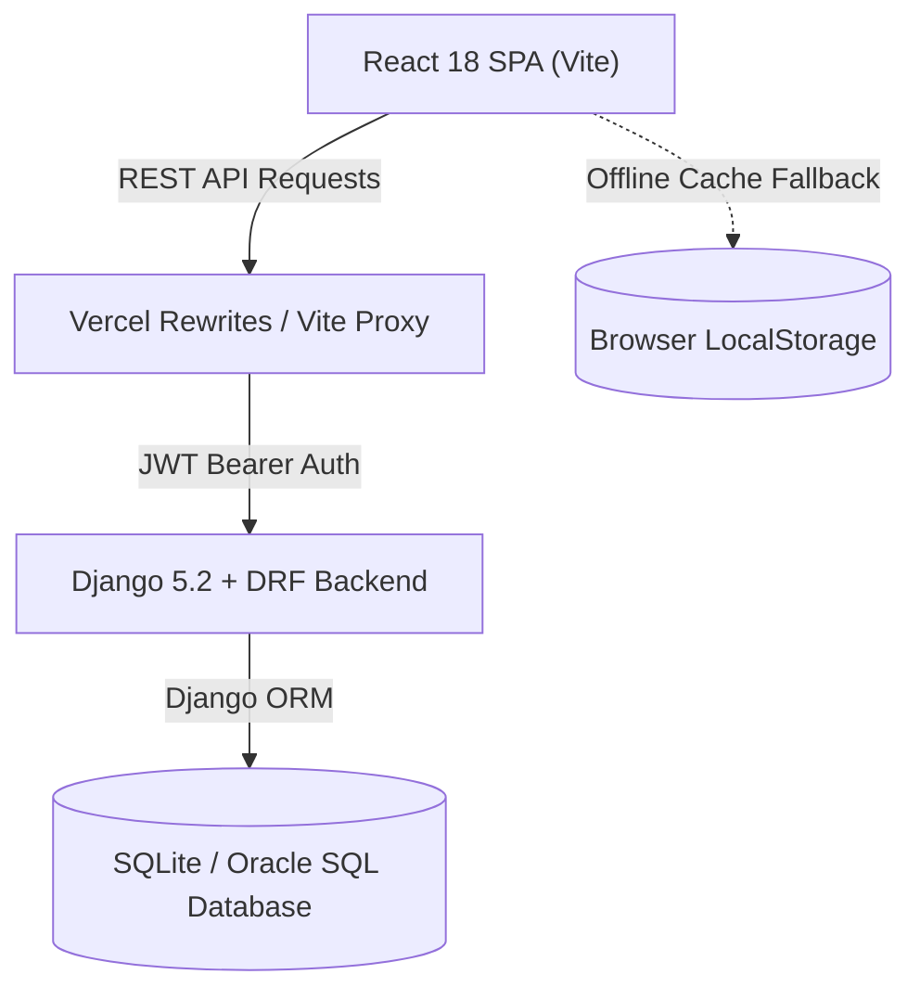

# ⚡ Muthu Selvam M — Full-Stack Developer Portfolio & CMS

<div align="center">

[](https://react.dev/)
[](https://www.djangoproject.com/)
[](https://www.django-rest-framework.org/)
[](https://www.python.org/)
[](https://vitejs.dev/)
[](https://jwt.io/)
[](https://www.oracle.com/database/)
[](https://vercel.com/)
[](https://render.com/)

**A high-performance, dynamic developer portfolio and full-featured Content Management System (CMS) designed for modern web engineers.**

[Live Public Portfolio](https://muthu-s-portfolio.vercel.app/) • [Admin Control Center](https://muthu-s-portfolio.vercel.app/#/admin) • [Report Bug](https://github.com/muthuselvamm472-pythonstack/muthu-s-portfolio/issues)

</div>

---

## 📖 Table of Contents
- [Overview](#overview)
- [Key Features](#key-features)
  - [Public Portfolio Showcase](#1-public-portfolio-showcase)
  - [Admin CMS & Control Center](#2-admin-cms--control-center)
  - [Intelligent Data & State Management](#3-intelligent-data--state-management)
- [Architecture & Tech Stack](#architecture--tech-stack)
- [Directory Structure](#directory-structure)
- [Database Schema & Design](#database-schema--design)
- [API Endpoints Reference](#api-endpoints-reference)
- [Getting Started](#getting-started)
  - [Prerequisites](#prerequisites)
  - [Local Development Setup](#local-development-setup)
  - [Running Both Servers Concurrently](#running-both-servers-concurrently)
- [Environment Configuration](#environment-configuration)
- [Admin Credentials & Management](#admin-credentials--management)
- [Deployment Guide](#deployment-guide)
  - [Frontend Deployment (Vercel)](#frontend-deployment-vercel)
  - [Backend Deployment (Render)](#backend-deployment-render)
- [Author & Contact](#author--contact)

---

## 🌟 Overview

This project is an **enterprise-grade, full-stack personal portfolio and live CMS** built by **Muthu Selvam M** (Python Full Stack Developer). 

Unlike static portfolio templates where code edits are required to update text, skills, or projects, this platform features an **integrated administration portal** powered by **Django REST Framework** and **React 18**. Any update made in the Admin Dashboard is instantly reflected on the public portfolio in real-time, backed by SQLite / Oracle SQL database persistence, silent JWT token rotation, and robust offline-first fallback capabilities.

---

## ✨ Key Features

### 1. Public Portfolio Showcase
- **Hero & Headline Engine**:
  - Configurable 3-line editorial hero headline with custom font pairings and golden radiance styling.
  - Interactive status pill (`Available for Full Stack Opportunities`) with real-time toggle.
  - Dynamic Typewriter component cycling through customizable role titles.
  - Direct resume download & external preview integration.
- **Interactive 3D Tech Carousel (`Tech3DCarousel`)**:
  - Custom 3D perspective stage showcasing 7 core technologies (*Python, Django, JavaScript, React.js, SQL Database, HTML5, CSS3*).
  - Smooth auto-rotation with depth scaling, blur defocus, and color-matched drop shadows.
  - Hover-to-pause and click-to-focus interactive physics.
- **About Section**:
  - Academic background (*BCA, CGPA: 7.8, Agurchand Manmull Jain College*).
  - Core competencies tag cloud and expandable bio descriptions.
- **Skills Matrix**:
  - Filterable categorized skills: *Programming, Frontend, Backend, Database, Tools, Soft Skills, QA*.
  - Custom visual ordering, visibility switches, and SVG icons.
- **Experience Timeline**:
  - Chronological career & internship entries with company details, date tags, and bulleted contributions.
- **Interactive Certifications**:
  - Credential cards with issuer badges (*Qspiders, Infosys Springboard, TCS iON, HP LIFE, NPTEL*).
  - Integrated image modal and high-resolution lightbox for proof-of-completion verification.
- **Projects Showcase**:
  - Rich project cards with short/detailed descriptions, tech badges, live demo links, and GitHub repository links.
  - Special `⭐ Featured` project highlighting.
- **Direct Contact System**:
  - Client-side validated contact form (*Name, Email, Subject, Message*).
  - Instant dispatch to the Django REST backend and logged into the Admin Inbox.
- **Theming & Global UI Polish**:
  - Seamless Light / Dark mode toggle with persistent local storage and root attribute binding.
  - Top scroll progress bar indicator, customized preloader animation, and scroll reveal transitions.

---

### 2. Admin CMS & Control Center
Accessible via `/#/admin` with secure JWT authorization:
- **Dashboard Overview**:
  - Live metric counters for received inquiries, active experiences, certifications, and projects.
  - Unread message indicators with instant preview.
- **Profile & Hero Manager**:
  - Real-time editing of personal details, contact data, tagline, typewriter list, and hero button targets.
- **Content CRUD Modules**:
  - **Skills Tab**: Add, edit, reorder, toggle visibility, and delete technical skills.
  - **Experience Tab**: Manage work experiences, training periods, and responsibilities.
  - **Certifications Tab**: Add credentials, upload certificate images (Base64 storage), and link verification URLs.
  - **Projects Tab**: Create/edit showcase projects with featured flags, repository URLs, and live links.
  - **Social Links Tab**: Manage social profiles (*GitHub, LinkedIn, Email, LeetCode, HackerRank, etc.*).
- **Messages Inbox**:
  - View all visitor inquiries with timestamp, author email, and subject.
  - Mark messages as read/unread or delete processed inquiries.
- **Theme & Section Settings**:
  - Customize site theme mode (*Light / Dark*), primary brand colors, and border radiuses.
  - Section visibility toggles: turn on/off *Hero, About, Skills, Experience, Certifications, Projects, Contact, Footer* with a single click.

---

### 3. Intelligent Data & State Management
- **Persistent State Merging (`PortfolioContext`)**:
  - Database-first architecture where Django API data takes authoritative precedence.
  - Preserves offline/unsynced temporary additions seamlessly in browser `localStorage`.
  - Automated collision resolution and sequential order normalization.
- **Silent JWT Auto-Refresh**:
  - 72-hour access tokens with 30-day refresh cycle.
  - Automatic interception of `401 Unauthorized` responses to refresh credentials silently without logging the admin out.
- **Render Cold-Start Protection**:
  - Built-in 45-second timeout controller with user-friendly alerts for sleeping free-tier backends.

---

## 🛠 Architecture & Tech Stack



### Frontend
| Component | Technology | Description |
| :--- | :--- | :--- |
| **Framework** | React 18.2 | Component-based UI library |
| **Routing** | React Router DOM v7 | HashRouter (`/#/`, `/#/admin`) for static host compatibility |
| **Build Tool** | Vite 5.1 | High-speed ESM development server & production bundler |
| **Icons** | Lucide React | Modern, lightweight icon suite |
| **Styling** | Vanilla CSS (CSS3) | Custom responsive design system, variables, dark/light themes |

### Backend
| Component | Technology | Description |
| :--- | :--- | :--- |
| **Framework** | Django 5.2 | High-level Python web framework |
| **API Layer** | Django REST Framework | RESTful endpoints, serializers, and permissions |
| **Authentication** | DRF SimpleJWT | JWT token lifecycle with rotation and blacklisting |
| **Database** | SQLite / Oracle SQL | Dual-compatible ORM backend with customized tables |
| **Static & Media** | WhiteNoise / Pillow | Static asset serving and image processing |
| **WSGI Server** | Gunicorn | Production Python WSGI HTTP Server |

---

## 📂 Directory Structure

```text
muthu's portfolio/
├── start_servers.bat           # 1-Click script to start both dev servers
├── vercel.json                 # Vercel deployment & API rewrite configuration
├── backend/
│   ├── manage.py               # Django management script
│   ├── requirements.txt        # Python backend dependencies
│   ├── .env.example            # Environment variables template
│   ├── muthu_portfolio.db      # Local SQLite database
│   ├── portfolio_backend/      # Django core configuration
│   │   ├── settings.py         # Settings, JWT, CORS, Database config
│   │   ├── urls.py             # Root URL routing
│   │   └── wsgi.py             # WSGI application entry
│   └── api/                    # Portfolio API application
│       ├── models.py           # Database models (Profile, Projects, etc.)
│       ├── serializers.py      # DRF ModelSerializers
│       ├── views.py            # API views & JWT authentication
│       ├── urls.py             # API route endpoints
│       └── management/
│           └── commands/
│               ├── seed_data.py               # Initial data seeding
│               └── set_admin_credentials.py   # Admin account setup
└── frontend/
    ├── package.json            # Node.js dependencies & scripts
    ├── vite.config.js          # Vite config with backend proxy
    ├── public/                 # Static assets, PDFs, & logos
    │   ├── Muthu_Selvam_Resume.pdf
    │   └── logos/              # Tech stack icons
    └── src/
        ├── App.jsx             # Root React component & route gating
        ├── apiConfig.js        # Dynamic backend URL resolution
        ├── mockData.js         # Default fallback data structure
        ├── context/            # React Context Providers
        │   ├── AuthContext.jsx       # Admin JWT authentication
        │   ├── PortfolioContext.jsx  # Central portfolio state & API sync
        │   ├── ThemeContext.jsx      # Light/Dark mode state
        │   └── SectionContext.jsx    # Section visibility state
        ├── components/
        │   ├── common/         # Preloader, ScrollProgress, Buttons, Modals
        │   ├── public/         # Hero, Tech3DCarousel, About, Skills, Projects, Contact
        │   └── dev/            # Admin Layout, CMS Tabs, and Control Panels
        └── styles/
            ├── global.css      # Base resets & typography
            ├── variables.css   # Color palette tokens
            ├── public.css      # Portfolio layout & 3D carousel styles
            └── admin.css       # Admin dashboard & modal styles
```

---

## 🗄 Database Schema & Design

All entities utilize explicit database table mappings to support both **SQLite** and **Oracle SQL**:

| Model Name | Database Table | Purpose |
| :--- | :--- | :--- |
| `Profile` | `PORTFOLIO_PROFILE` | Full name, titles, bio, headline lines, status badge, typewriter roles, and resume URL. |
| `About` | `PORTFOLIO_ABOUT` | Academic highlights, detailed background, and core technologies. |
| `Skill` | `PORTFOLIO_SKILL` | Categorized technical competencies, display order, and visibility flags. |
| `Experience` | `PORTFOLIO_EXPERIENCE` | Work history, roles, companies, dates, descriptions, and technology tags. |
| `Certification` | `PORTFOLIO_CERTIFICATION` | Certifications, issuing bodies, dates, URLs, and Base64 certificate media. |
| `Project` | `PORTFOLIO_PROJECT` | Showcase projects, descriptions, GitHub repo, live URLs, and featured flags. |
| `Message` | `PORTFOLIO_MESSAGE` | Visitor contact form submissions, read status, and timestamps. |
| `SocialLink` | `PORTFOLIO_SOCIAL_LINK` | External profile URLs (*GitHub, LinkedIn, Twitter, LeetCode*). |
| `SiteSettings` | `PORTFOLIO_SETTINGS` | Default theme, brand colors, border radius, and section visibility toggles. |

---

## 🔌 API Endpoints Reference

### Public Endpoints (No Authentication Required)
| Method | Endpoint | Description |
| :--- | :--- | :--- |
| `GET` | `/api/portfolio/` | Fetches the complete aggregated portfolio data (profile, about, skills, projects, etc.). |
| `POST` | `/api/contact/` | Submits a new contact inquiry from the public portfolio. |

### Authentication Endpoints
| Method | Endpoint | Description |
| :--- | :--- | :--- |
| `POST` | `/api/auth/login/` | Authenticates administrator and returns JWT Access & Refresh tokens. |
| `POST` | `/api/auth/logout/` | Blacklists refresh token and clears session. |
| `POST` | `/api/auth/token/refresh/` | Exchanges valid Refresh token for a new Access token. |
| `GET` | `/api/auth/me/` | Retrieves authenticated admin user metadata. |
| `POST` | `/api/auth/change-credentials/` | Updates admin username and password. |

### Admin Endpoints (Requires `Authorization: Bearer <token>`)
| Method | Endpoint | Description |
| :--- | :--- | :--- |
| `GET` | `/api/admin/stats/` | Overview metrics (inquiries, skills, projects, certifications count). |
| `PUT` | `/api/admin/profile/` | Updates personal profile, hero lines, and resume links. |
| `PUT` | `/api/admin/about/` | Updates About section information. |
| `GET` / `POST` | `/api/admin/skills/` | Lists or creates skills. |
| `PUT` / `DELETE`| `/api/admin/skills/<id>/` | Modifies or deletes a skill entry. |
| `GET` / `POST` | `/api/admin/experience/` | Lists or creates work experiences. |
| `PUT` / `DELETE`| `/api/admin/experience/<id>/` | Modifies or deletes an experience entry. |
| `GET` / `POST` | `/api/admin/certifications/` | Lists or creates certifications. |
| `PUT` / `DELETE`| `/api/admin/certifications/<id>/` | Modifies or deletes a certification. |
| `GET` / `POST` | `/api/admin/projects/` | Lists or creates projects. |
| `PUT` / `DELETE`| `/api/admin/projects/<id>/` | Modifies or deletes a project. |
| `GET` | `/api/admin/messages/` | Lists all contact messages. |
| `PATCH` / `DELETE`| `/api/admin/messages/<id>/` | Toggles message read status or deletes message. |
| `GET` / `POST` | `/api/admin/social/` | Lists or creates social media links. |
| `PUT` / `DELETE`| `/api/admin/social/<id>/` | Modifies or deletes a social link. |
| `PUT` | `/api/admin/settings/` | Updates site theme, color tokens, and section visibility. |

---

## 🚀 Getting Started

### Prerequisites
- **Node.js**: Version 18.0 or higher
- **Python**: Version 3.10 or higher
- **Git**

---

### Local Development Setup

#### 1. Clone the Repository
```bash
git clone https://github.com/muthuselvamm472-pythonstack/muthu-s-portfolio.git
cd "muthu's portfolio"
```

#### 2. Backend Setup (Django REST Framework)
```bash
# Navigate to backend directory
cd backend

# Create and activate virtual environment
python -m venv venv

# Windows:
venv\Scripts\activate
# macOS/Linux:
source venv/bin/activate

# Install dependencies
pip install -r requirements.txt

# Create .env from template
copy .env.example .env     # Windows
cp .env.example .env       # macOS/Linux

# Run database migrations
python manage.py migrate

# Seed initial portfolio data
python manage.py seed_data

# Create or verify admin user credentials
python manage.py set_admin_credentials

# Start Django development server
python manage.py runserver 127.0.0.1:8000
```

#### 3. Frontend Setup (React + Vite)
In a new terminal window:
```bash
# Navigate to frontend directory
cd frontend

# Install npm dependencies
npm install

# Start Vite development server
npm run dev
```

---

### Running Both Servers Concurrently
On Windows, you can simply double-click the included automation batch file:
```cmd
start_servers.bat
```
This will launch:
1. **Django REST API**: `http://127.0.0.1:8000/`
2. **Vite React Frontend**: `http://127.0.0.1:3000/`

---

## ⚙️ Environment Configuration

Create a `.env` file in the `backend/` directory based on `.env.example`:

```env
# Django Settings
DJANGO_SECRET_KEY=your-custom-django-secret-key-change-in-production
DJANGO_DEBUG=True
DJANGO_ALLOWED_HOSTS=localhost,127.0.0.1,testserver,*

# Database Choice: 'sqlite' (default, zero setup) | 'oracle'
DB_BACKEND=sqlite

# Oracle Database Credentials (only needed if DB_BACKEND=oracle)
ORACLE_USER=SYSTEM
ORACLE_PASSWORD=your_oracle_password
ORACLE_DSN=localhost:1521/ORCL

# JWT Token Lifetime Settings
JWT_ACCESS_TOKEN_LIFETIME_HOURS=72
JWT_REFRESH_TOKEN_LIFETIME_DAYS=30

# Default Admin User Setup
ADMIN_USERNAME=muthu
ADMIN_PASSWORD=Admin@2026

# CORS Allowed Origins
CORS_ALLOWED_ORIGINS=http://localhost:3000,http://127.0.0.1:3000,https://muthu-s-portfolio.vercel.app
```

---

## 🔐 Admin Credentials & Management

- **Default Admin Route**: `http://localhost:3000/#/admin`
- **Default Username**: `muthu` *(or configured in `.env`)*
- **Default Password**: `Admin@2026`

To change the admin password at any time via CLI:
```bash
python manage.py set_admin_credentials --username your_username --password your_new_password
```
Alternatively, log in to `/#/admin` and navigate to the top-right user menu to change credentials directly from the browser.

---

## 🌐 Deployment Guide

### Frontend Deployment (Vercel)
The repository includes a root `vercel.json` with API rewrite routing.
1. Connect your repository to [Vercel](https://vercel.com/).
2. Set **Root Directory** to `frontend`.
3. Set **Framework Preset** to `Vite`.
4. Configure Build Command: `npm run build` and Output Directory: `dist`.
5. *(Optional)* Add Environment Variable:
   - `VITE_API_URL`: Your live backend URL (e.g. `https://muthu-portfolio-backend.onrender.com`).
6. Deploy!

### Backend Deployment (Render)
1. Create a **New Web Service** on [Render](https://render.com/).
2. Connect this repository and set **Root Directory** to `backend`.
3. Set **Runtime** to `Python 3`.
4. Set **Build Command**:
   ```bash
   pip install -r requirements.txt && python manage.py migrate && python manage.py seed_data && python manage.py collectstatic --noinput
   ```
5. Set **Start Command**:
   ```bash
   gunicorn portfolio_backend.wsgi:application
   ```
6. Add Environment Variables from your `.env`:
   - `DJANGO_SECRET_KEY`: `<secure-secret-key>`
   - `DJANGO_DEBUG`: `False`
   - `DJANGO_ALLOWED_HOSTS`: `.onrender.com,localhost,127.0.0.1`
   - `CORS_ALLOWED_ORIGINS`: `https://muthu-s-portfolio.vercel.app`

---

## 👨‍💻 Author & Contact

**Muthu Selvam M**  
*Python Full Stack Developer*  
📍 Chennai, Tamil Nadu, India  

- **Portfolio**: [muthu-s-portfolio.vercel.app](https://muthu-s-portfolio.vercel.app/)
- **GitHub**: [@muthuselvamm472-pythonstack](https://github.com/muthuselvamm472-pythonstack)
- **LinkedIn**: [linkedin.com/in/muthuselvamm472](https://www.linkedin.com/in/muthuselvamm472)
- **Email**: [muthuselvamm472@gmail.com](mailto:muthuselvamm472@gmail.com)
- **Phone**: +91 86789 22362

---

<div align="center">
  <sub>Built with ❤️ by Muthu Selvam M. Star ⭐ this repository if you found it useful!</sub>
</div>
